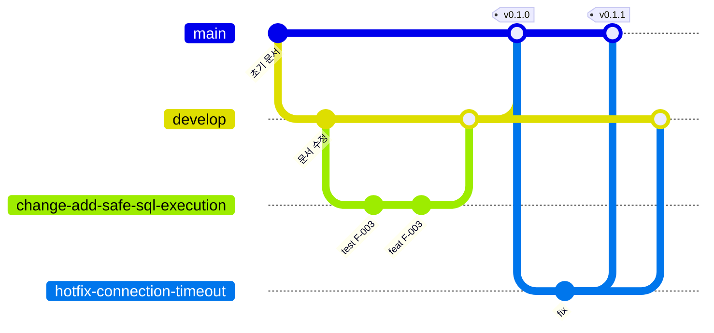

# 브랜치 컨벤션

`main`은 언제든 파일럿에 배포할 수 있는 상태로 두고, 개발은 `develop`에 모은다. OpenSpec change 하나는 브랜치 하나에서 구현한다.

## 브랜치

| 브랜치 | 역할 | 어디서 만드나 | 어디로 합치나 |
|---|---|---|---|
| `main` | 언제든 배포 가능한 상태. 파일럿에 배포되는 코드 | — | — |
| `develop` | change를 모으는 곳. 개발 서버에 배포 | `main` | `main` (릴리스) |
| `change/<change-id>` | OpenSpec change 하나 구현. Ralph 루프가 일하는 곳 | `develop` | `develop` |
| `fix/<짧은-설명>` | change가 아닌 작은 버그 수정 | `develop` | `develop` |
| `chore/<짧은-설명>` | 기능이 아닌 개발 환경·설정 작업 (하네스, CI, 빌드 설정 등) | `develop` | `develop` |
| `hotfix/<짧은-설명>` | 배포된 `main`의 급한 수정 | `main` | `main`과 `develop` 둘 다 |

`<change-id>`는 OpenSpec change 이름을 그대로 쓴다. 예) `change/add-safe-sql-execution`
`<짧은-설명>`은 영어 소문자와 하이픈으로 쓴다. 예) `fix/empty-chart-title`

## 흐름

그림에서는 Mermaid 문법 때문에 `/` 대신 `-`로 적었다. 실제 이름은 `change/add-safe-sql-execution`, `hotfix/connection-timeout`이다.

## 규칙

1. **change:** `develop`에서 `change/<change-id>`를 만든다. 구현, 검토, archive까지 이 브랜치에서 끝내고 `develop`으로 PR을 연다([하네스 규칙](harness.md)).
2. **문서만 바꿀 때:** 브랜치 없이 `develop`에 바로 커밋한다.
3. **릴리스:** `develop` → `main` PR을 릴리스 템플릿으로 열고(`gh pr create --base main --template release.md`), CI와 평가 세트가 통과하면 merge한다. merge 뒤 `main`에 태그를 붙인다.
4. **hotfix:** `main`에서 만들어 `main`에 merge하고 패치 태그를 붙인 뒤, 같은 브랜치를 `develop`에도 merge한다.
5. **직접 커밋 금지:** `main`에는 직접 커밋하지 않는다. 릴리스와 hotfix PR로만 바뀐다. `develop`에는 문서 커밋만 직접 한다.
6. **병합 방식:** squash하지 않고 merge commit으로 합친다. Ralph가 작업마다 남긴 커밋을 보존해 작업 단위로 되돌릴 수 있게 한다.
7. **정리:** merge한 `change/`, `fix/`, `chore/`, `hotfix/` 브랜치는 지운다.
8. **보호:** GitHub 브랜치 보호로 `main`과 `develop`은 PR로만 합치고 CI 통과를 필수로 한다. CI가 생기는 하네스 구성 단계(로드맵 5-1)에서 설정한다.

## 태그

`v<MAJOR>.<MINOR>.<PATCH>` 형식을 쓴다.

| 올리는 자리 | 언제 |
|---|---|
| MINOR | `develop` → `main` 릴리스 |
| PATCH | hotfix |
| MAJOR | MVP가 끝나고 정식 서비스로 넘어갈 때 (`v1.0.0`) |

MVP의 첫 파일럿 배포가 `v0.1.0`이다.
