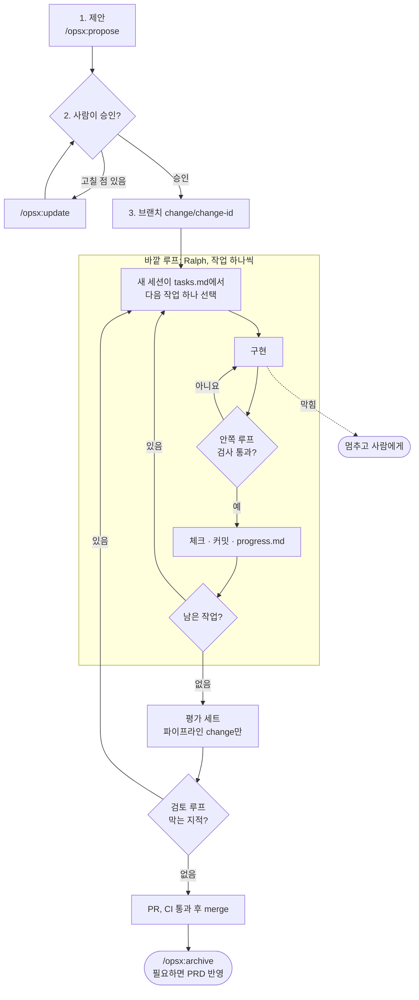

# 하네스 규칙 (OpenSpec 기반 개발 흐름)

AskFlow는 OpenSpec으로 만든 스펙을 AI 에이전트(Claude Code)에게 맡겨 구현한다. 맡기는 방식을 세 층으로 나눈다.

| 층 | 답하는 질문 | AskFlow에서 |
|---|---|---|
| **스펙** | 무엇을 만들고, 언제 끝났다고 보나 | OpenSpec change의 요구사항, 시나리오, tasks.md ([스펙 관리 규칙](spec.md)) |
| **하네스** | 어떤 환경에서, 무엇으로 확인하나 | 2장의 여섯 가지 하네스 |
| **루프** | 어떻게 반복시켜 끝까지 가게 하나 | 3장의 세 겹 루프 |

스펙이 끝나는 조건을 정하고, 하네스가 그 조건을 자동으로 판정하고, 루프가 판정이 날 때까지 에이전트를 돌린다.

## 1. 전체 흐름

change 하나를 이렇게 진행한다. 문서만 바꾸는 커밋은 이 흐름 없이 바로 커밋해도 된다.

1. **제안:** `/opsx:propose`로 change를 만든다. tasks.md의 첫 작업 묶음은 시나리오를 실패하는 테스트로 옮기는 일이다(`openspec/config.yaml` 규칙).
2. **승인:** 사람이 proposal, specs, design, tasks를 읽고 승인한다. 고칠 점은 `/opsx:update`로 고친다. 승인 전에는 구현하지 않는다.
3. **브랜치:** change마다 `change/<change-id>` 브랜치를 만든다.
4. **구현:** 바깥 루프(Ralph)가 tasks.md의 작업을 하나씩 구현한다. 대화하며 직접 진행하고 싶으면 `/opsx:apply`를 써도 된다.
5. **평가:** 파이프라인(F-001, F-002, F-004, F-005)을 바꾼 change는 평가 세트를 돌려 정답률을 기록한다.
6. **검토:** 검토 루프에서 막는 지적이 없어질 때까지 고친다.
7. **PR과 CI:** PR을 열고, CI 검사가 모두 통과하면 merge한다.
8. **마무리:** `/opsx:archive`로 스펙을 합친다. 구현하며 요구사항이 바뀌었다면 PRD도 고친다(스펙 관리 규칙 4번).

사람이 판단하는 곳은 루프 앞(change 승인)과 뒤(검토 결과와 PR 승인)다. 루프가 도는 동안에는 개입하지 않고, 루프가 막혔다고 알려 올 때만 판단한다.

## 2. 하네스: 에이전트가 일하는 환경

### 2-1. 컨텍스트 하네스

에이전트가 무엇을 보고 일하는지 정한다.

- **지도:** 루트 `CLAUDE.md`에는 프로젝트 한 줄 설명, 기준 문서와 규칙 문서의 위치, 개발 명령만 짧게 적는다. 폴더별 설명이 필요해지면 그 폴더에 `CLAUDE.md`를 둔다.
- **기준 문서:** 레포 안 문서가 기준이다. 제품은 `docs/mvp/`, 동작 스펙은 `openspec/`, 규칙은 `conventions/`에 있다. 대화에서 정한 결정은 문서에 남긴다.
- **작업 컨텍스트:** 지금 하는 change의 proposal, specs, design, tasks와 진행 메모(`progress.md`)만 읽으면 일을 시작할 수 있어야 한다.
- **인수인계:** 세션이 바뀌어도 tasks.md의 체크 상태, 커밋, `progress.md`로 이어 간다. 대화 기록에 기대지 않는다.

### 2-2. 퍼미션 하네스

에이전트가 할 수 있는 범위를 정한다. 설정은 `.claude/settings.json`에 둔다.

| 단계 | 대상 |
|---|---|
| 허용 | 테스트, 린트, 타입 검사, 평가 실행, `openspec` 명령, `git status`·`diff`·`log`·`add`·`commit` |
| 확인 | `git push`, 패키지 추가, DB 마이그레이션 실행 |
| 거부 | `.env`와 `data/raw/` 읽기·쓰기, `git push --force`, 파일럿 DB 접속 |

훅(PreToolUse)으로 추가로 막는 것:

- [커밋 컨벤션](commit.md) 형식이 아닌 커밋 메시지
- 바깥 루프가 도는 동안 이미 있는 시나리오 테스트 수정. 테스트가 틀렸다면 루프를 멈추고 사람이 고친다

### 2-3. 검증 하네스

구현한 에이전트의 "다 됐다"를 믿지 않고, 테스트와 자동 검사와 독립 검토로 확인한다.

- **테스트:** 시나리오(WHEN/THEN)마다 자동 테스트를 하나 이상 둔다. 테스트 이름에 기능 ID를 넣는다.
- **자동 검사:**

  | 검사 | 훅에서 | CI에서 |
  |---|---|---|
  | 포맷·린트 | 파일을 고칠 때마다 (PostToolUse) | 모든 push |
  | 타입 검사 | 턴을 끝낼 때 (Stop) | 모든 push |
  | 테스트 | 턴을 끝낼 때 (Stop). 빠른 단위 테스트만 | 모든 push. 통합 테스트 포함 |
  | `openspec validate --strict` | change 문서를 고친 턴의 끝 (Stop) | 모든 push |

- **평가 세트:** Olist 질문 30개, 대시보드·보고서 요청 10개로 정답률을 잰다. LLM 비용이 드니 바깥 루프가 끝난 뒤 한 번, 그리고 파이프라인 change의 PR에서 돌린다. 정답률이 직전 기록보다 3%p 넘게 떨어지면 merge하지 않는다(초안).
- **독립 검토:** 3-3의 검토 루프.

### 2-4. 도구 하네스

같은 일을 두 도구가 하지 않게 역할을 나눈다.

| 도구 | 맡는 일 |
|---|---|
| 기본 도구 (파일 읽기·수정, 셸) | 구현 |
| OpenSpec 스킬 (`/opsx:*`) | change 제안, 수정, 대화형 구현, archive |
| Ralph (`scripts/ralph/`) | 바깥 루프 실행. 작업 목록은 OpenSpec tasks.md이고, Ralph의 `prd.json`은 쓰지 않는다 |
| 훅 | 자동 검사와 금지 작업 차단 (2-2, 2-3) |
| 프로젝트 전용 스킬 (하네스 구성 때 만든다) | 평가 세트 실행, Olist 시드, 요청 하나 재현 |
| MCP (선택) | 개발 DB 스키마를 읽기 전용으로 조회. 파일럿 DB에는 붙이지 않는다 |

### 2-5. 서브에이전트·워크트리 하네스

작업을 격리하고 역할을 나눈다.

- **격리:** change마다 `change/<change-id>` 브랜치에서 일한다. 여러 change를 동시에 진행할 때는 worktree로 폴더를 나눈다.
- **역할 분리:**

  | 역할 | 누가 |
  |---|---|
  | 계획 | `/opsx:propose`를 돌리는 세션 |
  | 구현 | Ralph의 반복 세션 (반복마다 새 세션) |
  | 검토 | 구현과 컨텍스트를 공유하지 않는 리뷰 서브에이전트나 `/code-review` |
  | 탐색 | 코드·문서 찾기용 서브에이전트. 결과만 받는다 |

### 2-6. 디버깅 하네스

에이전트가 스스로 문제를 찾을 수 있게 정보를 정리해 둔다. TextToSQL은 결과가 틀렸을 때 어디서 틀렸는지 찾기 어려워 특히 중요하다.

- **실행 기록:** 요청마다 요청 → 계획 → 생성 SQL → 실행 결과(행 수와 열 이름) → 오류를 파일로 남긴다. 결과 값과 개인정보는 남기지 않고, 기록 파일은 커밋하지 않는다. 경로는 STEP 5에서 정한다.
- **재현 명령:** 실행 기록의 ID로 요청 하나를 그대로 다시 돌린다.
- **평가 실패 리포트:** 틀린 문항마다 기대한 SQL·값과 실제 SQL·값을 나란히 보여 준다.
- **환경 정리:** 필요한 환경 변수는 `.env.example`에 설명과 함께 적고, 무엇을 설정 파일에 두고 무엇을 환경 변수로 둘지 표로 정리한다.
- **오류 메시지:** 원인과 확인할 곳을 함께 보여 준다(PRD F-003의 연결 오류처럼).

## 3. 루프: 에이전트를 끝까지 돌리는 방식

### 3-1. 안쪽 루프 (한 턴 안)

에이전트가 파일을 고치면 훅이 포맷·린트를 돌리고, 턴을 끝내려 하면 Stop 훅이 타입 검사, 빠른 테스트, `openspec validate`를 돌린다. 실패하면 턴을 끝내지 못하고 고친다.

### 3-2. 바깥 루프 (작업 하나씩, Ralph)

`scripts/ralph/ralph.sh <change-id>`로 돌린다. 반복마다 새 세션이 [scripts/ralph/prompt.md](../scripts/ralph/prompt.md)를 받아 작업 하나를 끝낸다.

**한 번의 반복**

1. 규칙 문서와 change 문서(proposal, design, specs, tasks), `progress.md`를 읽는다.
2. tasks.md에서 체크되지 않은 첫 작업 하나를 고른다. 마지막 묶음(검토와 완료 조건 확인)은 하지 않는다. 그건 검토 루프의 몫이다.
3. 그 작업만 구현한다(안쪽 루프).
4. 작업에 적힌 확인 방법과 자동 검사가 통과하면 tasks.md에 체크하고 커밋 컨벤션대로 커밋한다. push는 하지 않는다.
5. `progress.md`에 한 일과 다음 반복이 알아 둘 것을 남기고 끝낸다.

**규칙**

- **작업 크기:** 작업 하나는 새 세션 한 번에 끝낼 크기여야 한다(OpenSpec tasks 규칙).
- **기준 문서는 하나:** 작업 목록은 OpenSpec tasks.md뿐이다. `ralph-skills:ralph`로 PRD를 `prd.json`으로 바꾸지 않는다.
- **진행 메모:** `openspec/changes/<change-id>/progress.md`. 맨 위에 다시 쓸 만한 패턴을 모으고, 아래에 반복 기록을 덧붙인다. change와 함께 archive된다.
- **끝:** 마지막 묶음을 뺀 작업이 모두 체크되고 검사가 통과하면 루프를 멈추고 검토 루프로 넘긴다.
- **멈추고 사람에게 넘기는 경우:** 이미 있는 시나리오 테스트를 고쳐야 통과할 것 같을 때, change 범위 밖 수정이 필요할 때, 스펙이 모호해 판단이 필요할 때, 같은 작업이 세 번 실패했을 때, 최대 반복 수(기본은 남은 작업 수의 두 배)에 닿았을 때.
- **권한:** 반복 세션은 `--permission-mode acceptEdits`로 돌린다. 파일 수정은 허용하고, 셸 명령은 퍼미션 하네스의 허용 목록 안에서만 쓴다.

### 3-3. 검토 루프 (구현과 분리)

바깥 루프가 끝나면, 구현에 참여하지 않은 리뷰어가 change 문서와 diff를 함께 보고 아래를 확인한다. 지적은 **막음**(merge 전에 반드시 고친다)과 **제안**으로 나눈다. 막는 지적이 있으면 tasks.md에 고칠 작업을 추가하고 바깥 루프로 돌려보낸다.

1. specs의 시나리오마다 테스트가 있고, 테스트가 그 WHEN/THEN을 실제로 확인한다.
2. change의 범위(proposal, tasks) 밖의 수정이 없다.
3. F-003 기준(SELECT만 실행, 행 수·시간 상한, 개인정보 컬럼 가리기)을 피해 가는 코드 경로가 없다.
4. 보고서 서술의 숫자가 결과 데이터 밖에서 나오지 않는다(PRD F-004 기준).
5. 커밋이 컨벤션을 따르고 기능 ID가 붙어 있다.
6. 비밀 값이나 원본 데이터가 커밋되지 않았다.

## 4. change 완료 조건

아래를 모두 채워야 archive한다.

- [ ] tasks.md의 작업이 모두 체크됐다.
- [ ] 시나리오마다 테스트가 있고 모두 통과한다.
- [ ] CI가 통과했다.
- [ ] 검토에서 막는 지적이 없다.
- [ ] 파이프라인 change라면 평가 세트 결과를 PR에 적었다.
- [ ] 요구사항이 바뀌었다면 PRD도 고쳤다.

## 5. 기술 스택이 정해지면 채울 것

STEP 5에서 기술 스택을 정한 뒤 하네스를 구성하며 채운다(로드맵 5-1).

| 항목 | 명령 |
|---|---|
| 포맷·린트 | 미정 |
| 타입 검사 | 미정 |
| 빠른 단위 테스트 (Stop 훅용) | 미정 |
| 전체 테스트 (CI용) | 미정 |
| 평가 세트 실행 | 미정 |
| 요청 하나 재현 | 미정 |
