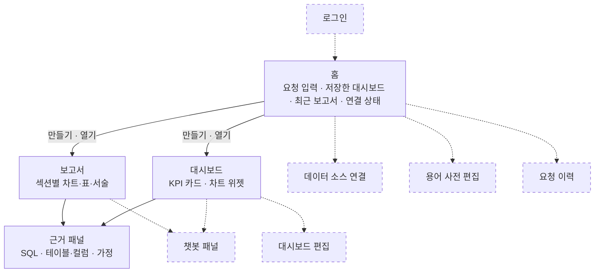
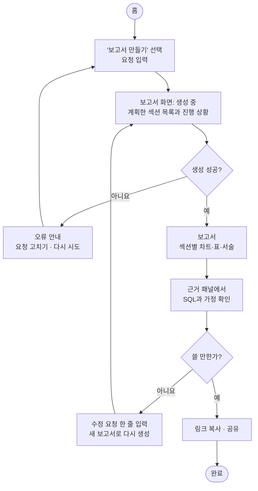
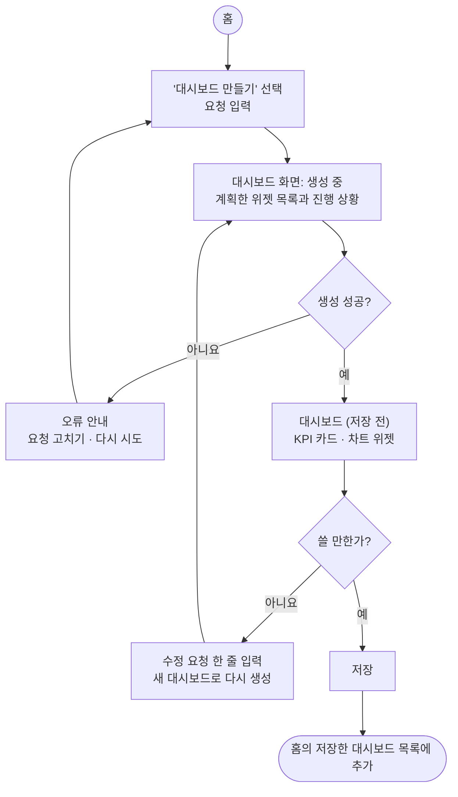
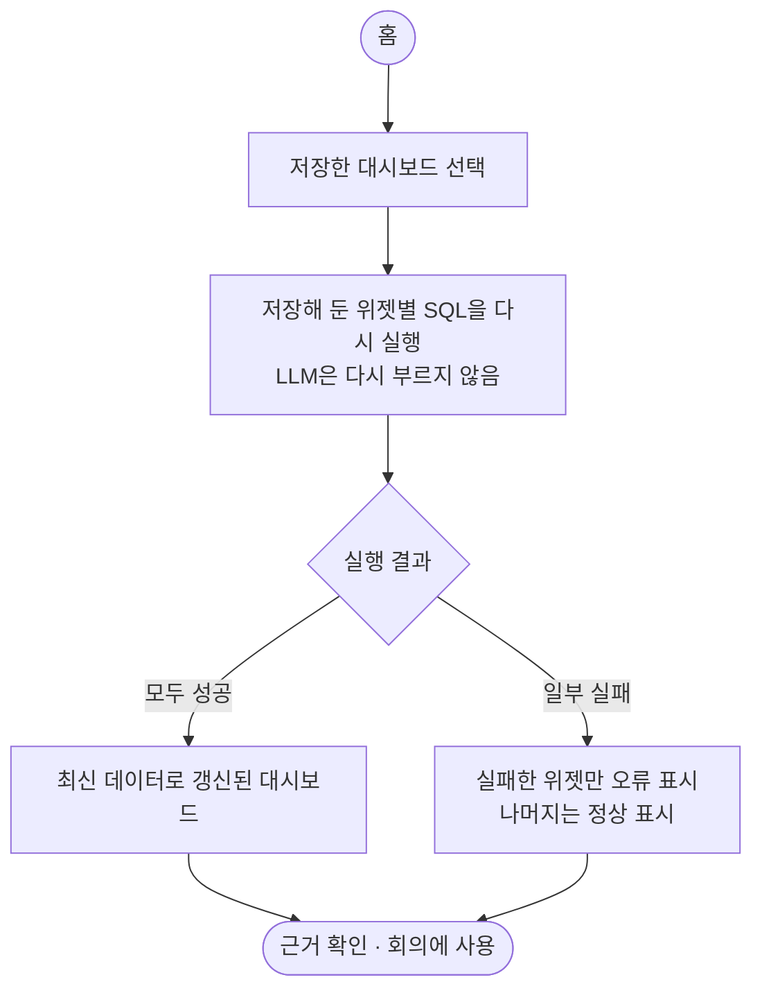
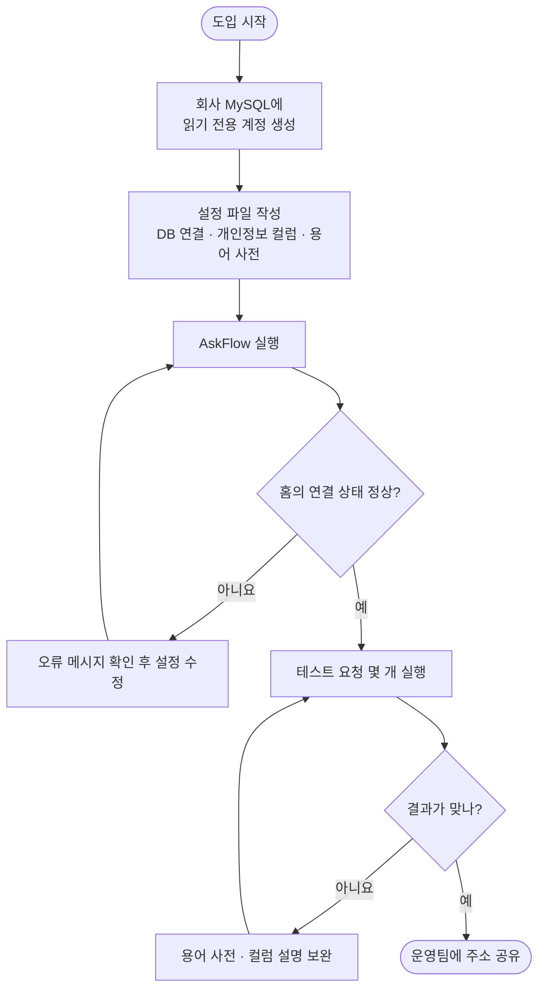

# STEP 3. IA (정보 구조)

- 작성일: 2026-10-26
- 상태: 초안. 화면과 흐름은 [기획서](02-service-plan.md)의 페르소나, 시나리오, Must 기능(F-001~F-005)을 바탕으로 한다.
- 다이어그램은 로드맵 원칙대로 Mermaid로 그렸다. GitHub에서 바로 그림으로 보인다.

## 1. 화면 목록

MVP에는 로그인이 없고, 데이터 소스 연결과 용어 사전은 설정 파일로 관리한다. 그래서 화면은 세 개와 패널 하나로 충분하다.
"생성 중"은 따로 화면을 두지 않고, 보고서·대시보드 화면이 만들어지는 동안 보여 주는 상태로 둔다.

| 화면 | 경로 (안) | 역할 | 관련 기능 |
|---|---|---|---|
| 홈 | `/` | 요청 입력(대시보드·보고서 선택), 저장한 대시보드 목록, 최근 보고서 목록, 데이터 연결 상태 | F-001 |
| 보고서 | `/reports/:id` | 섹션별 차트·표·서술. 근거 열기, 수정 요청, 링크 복사 | F-004 |
| 대시보드 | `/dashboards/:id` | KPI 카드와 차트 위젯 그리드. 근거 열기, 수정 요청, 저장 | F-005 |
| 근거 패널 | 보고서·대시보드 위에 열림 | 숫자나 위젯별 SQL, 사용한 테이블·컬럼, 해석한 가정, 확신이 낮을 때 경고 | F-002, F-003 |

**화면별 상태**

| 화면 | 상태 |
|---|---|
| 홈 | 처음 쓸 때(저장한 대시보드·보고서 없음): 예시 요청 문장을 보여 준다. 연결 실패: 연결 상태에 오류와 확인할 설정을 보여 준다 |
| 보고서·대시보드 | 생성 중: 계획한 섹션·위젯 목록과 진행 상황. 실패: 오류 안내와 "요청 고치기·다시 시도". 일부 실패: 실패한 섹션·위젯만 오류로 표시 |
| 근거 패널 | 확신 낮음: 가정이 여러 개이거나 결과가 비어 있으면 경고를 보여 준다 |

## 2. 사이트맵

점선은 MVP 이후(Should·Could)에 생길 화면이다.

## 3. 핵심 유저 플로우

### 플로우 1. 비정형 보고서 만들기 (P1, 기획서 시나리오 1)

### 플로우 2. 정형 대시보드 만들고 저장하기 (P1, 기획서 시나리오 2)

### 플로우 3. 저장한 대시보드 다시 보기 (P1, 기획서 시나리오 2의 4단계)

가설 H4(저장한 대시보드를 반복해서 연다)를 재는 흐름이다.

### 플로우 4. 도입과 연결 (P3, 기획서 시나리오 3)

MVP에서는 화면 밖(설정 파일)에서 대부분 이뤄진다.

## 4. IA를 그리며 정한 것

| 항목 | 결정 | 이유 |
|---|---|---|
| 계획 확인 | 생성 중에 계획한 섹션·위젯 목록을 보여 주되, 승인받지는 않는다 | 승인 단계를 넣으면 한 번 더 기다려야 한다. 계획이 틀리면 수정 요청으로 고친다 |
| 수정 요청 | 원본을 덮어쓰지 않고 새 보고서·대시보드를 만든다 | 이미 공유한 링크의 내용이 바뀌면 받은 사람이 혼란스럽다 |
| 대시보드 갱신 | 저장할 때 위젯별 SQL과 차트 설정을 저장하고, 다시 열 때 SQL만 다시 실행한다 | LLM을 다시 부르지 않아 빠르고, 열 때마다 구성이 달라지지 않는다 |
| 대시보드 저장 | 저장하면 새 대시보드로 추가된다. 기존 대시보드 덮어쓰기는 MVP 이후 | 저장 흐름을 단순하게 둔다 |
| 목록 범위 | 로그인이 없으므로 홈의 목록은 그 배포를 쓰는 모두에게 같다 | 파일럿은 회사마다 따로 띄우므로 회사 안에서만 공유된다 |
| 연결 상태 | 홈에 데이터 연결 상태(연결 여부, 테이블 수, 용어 수)를 보여 준다 | P3가 설정 파일을 고친 뒤 화면에서 바로 확인할 수 있다. PRD에서 어느 기능 ID에 넣을지 정한다 |

## 5. 검토하며 찾은 문제와 반영

| 찾은 문제 | 반영 |
|---|---|
| 가설 H6은 대시보드도 수정 요청으로 고친다고 보는데, 기획서 F-005에는 수정 요청이 없었다 | 기획서 F-005에 한 줄 수정 요청을 추가했다 |
| Olist 데이터는 2016~2018년이라 "지난 7일" 같은 요청을 하면 결과가 비어 버린다 | 로드맵의 데이터셋 항목에 기준 날짜 처리를 추가했다 |
| P3가 설정을 마친 뒤 연결이 됐는지 확인할 곳이 없었다 | 홈에 연결 상태를 두었다 (4장) |
| 수정 요청이 공유된 원본을 바꾸면 링크를 받은 사람이 다른 내용을 보게 된다 | 수정 요청은 새 결과를 만든다 (4장) |

## 6. 다음 단계

- **STEP 4 PRD:** 화면과 플로우를 기준으로 Must 5개의 유저 스토리와 수용 기준을 쓴다. 연결 상태 표시를 어느 기능에 넣을지도 정한다.
