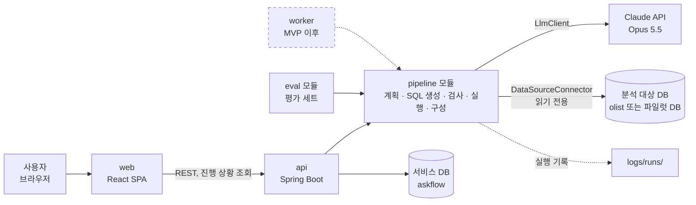
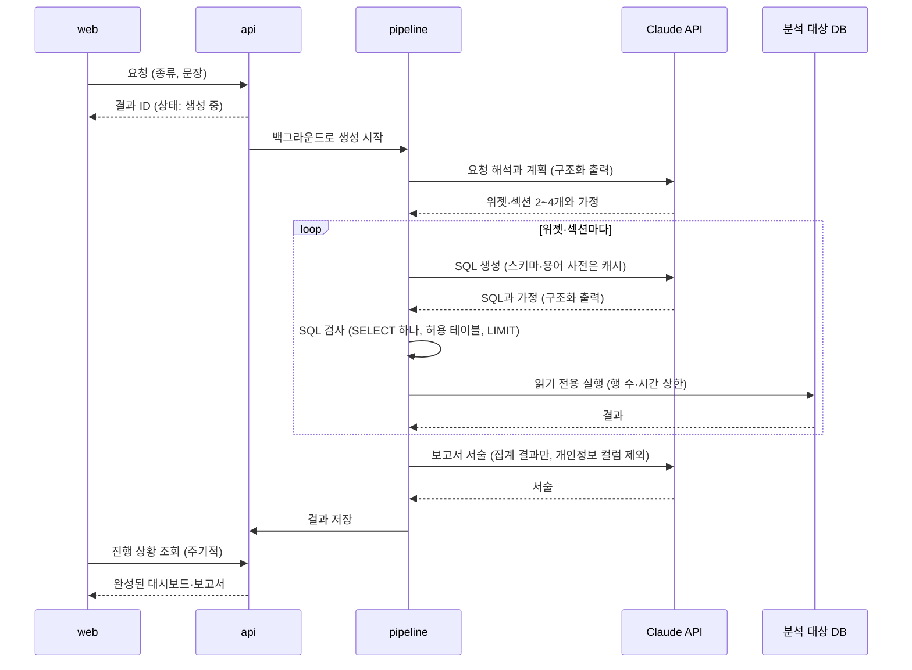
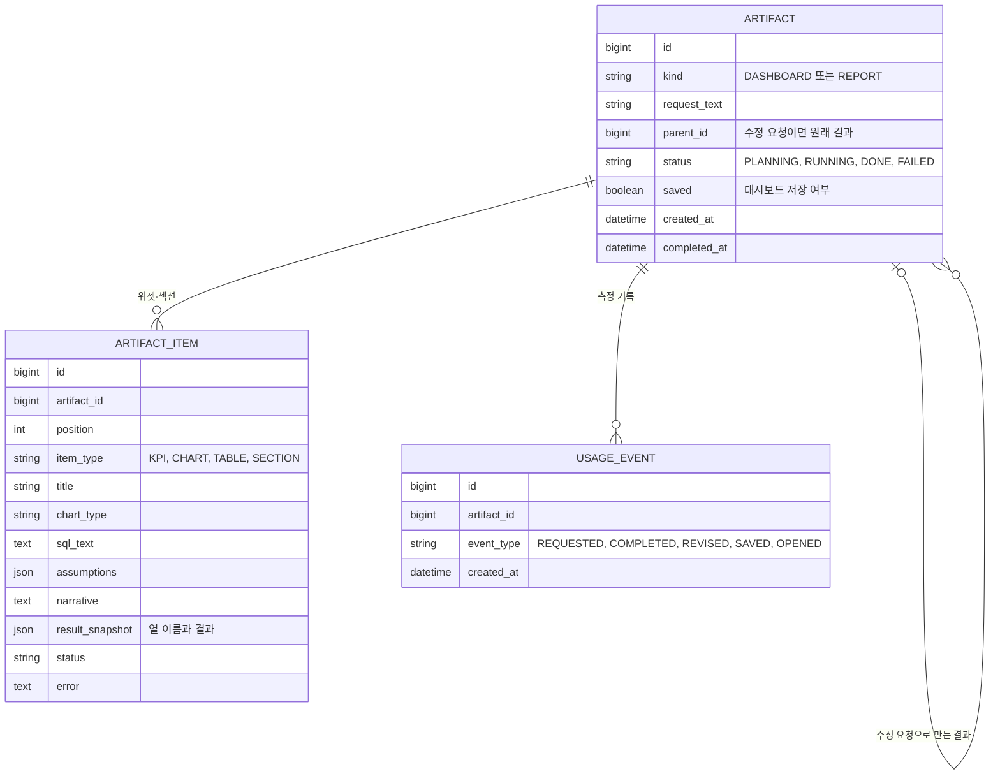

# STEP 5. 아키텍처

- 작성일: 2026-10-27
- 상태: 초안. 라이브러리 버전과 명령은 하네스 구성(로드맵 5-1)에서 확정한다.
- 근거: [PRD](04-prd.md), [IA](03-ia.md), [로드맵의 확정한 것](mvp-roadmap.md#확정한-것)

## 1. 결정 요약

| 항목 | 결정 |
|---|---|
| 백엔드 | Spring Boot, Kotlin, Gradle(Kotlin DSL) 멀티 모듈 |
| 프론트엔드 | React + TypeScript + Vite, shadcn/ui, 차트는 Recharts |
| DB | MySQL 서버 하나에 DB 둘. `askflow`(서비스 데이터)와 `olist`(분석 대상, 읽기 전용) |
| LLM | Claude API, 공식 Java SDK. 기본 모델 Claude Opus 5.5 |
| 생성 방식 | API 프로세스 안의 백그라운드 작업. 화면은 진행 상황을 주기적으로 조회한다 |
| Olist 날짜 | 시드할 때 7일 단위로 최근으로 옮긴다 |
| 로컬 환경 | Docker Compose (MySQL) |

## 2. 시스템 구성



- **pipeline 모듈이 핵심이다.** 요청 해석부터 대시보드·보고서 구성까지 여기서 한다. api, eval, 나중의 worker가 같은 모듈을 쓴다. 그래서 워커를 분리할 때 pipeline을 옮기지 않고 호출하는 쪽만 바꾸면 된다.
- **바깥 세계와는 인터페이스로만 닿는다.** LLM은 `LlmClient`, 분석 대상 DB는 `DataSourceConnector`, 실행 기록은 `RunLogger` 뒤에 둔다. MVP 구현체는 Anthropic SDK, MySQL, 파일이다. 엑셀·시트 커넥터나 다른 LLM은 구현체를 추가해 붙인다.
- **pipeline은 Spring에 기대지 않는 순수 Kotlin으로 둔다.** 그래서 단위 테스트가 빠르고, 하네스의 Stop 훅에서 매번 돌릴 수 있다.

## 3. 레포 구조

```
askflow/
├── api/            # Spring Boot 앱: REST, 서비스 DB, 구현체 연결
├── pipeline/       # 순수 Kotlin 라이브러리: 생성 파이프라인과 인터페이스
├── eval/           # 평가 세트 실행, 실패 리포트, 요청 재현
├── web/            # React 앱
├── scripts/
│   ├── ralph/      # Ralph 루프
│   └── seed/       # Olist 적재와 날짜 옮기기
├── data/raw/       # Olist 원본 (커밋하지 않음)
├── logs/           # 실행 기록 (커밋하지 않음)
├── docs/, openspec/, conventions/
└── docker-compose.yml
```

`worker/`는 MVP 이후 워커를 분리할 때 만든다.

## 4. 생성 흐름

### 4-1. 대시보드·보고서 만들기 (F-001 ~ F-005)



- **진행 상황:** 화면은 결과 ID로 1~2초마다 상태를 조회한다. IA의 "생성 중" 상태에서 계획한 위젯·섹션 목록을 보여 주는 데 쓴다. 서버 푸시(SSE)는 MVP 이후다.
- **수정 요청:** 원래 결과와 수정 문장을 함께 넣어 새 결과를 만든다. 원래 결과는 그대로 둔다(IA 4장).
- **부분 실패:** 위젯·섹션 하나가 실패해도 나머지는 계속 만든다. 실패한 것은 오류와 원인을 저장한다.

### 4-2. 저장한 대시보드 다시 열기 (F-005)

저장할 때 위젯마다 SQL과 차트 설정을 저장한다. 다시 열면 LLM을 부르지 않고 저장한 SQL만 다시 실행해, 구성은 그대로 두고 숫자만 최신으로 바꾼다.

## 5. 서비스 DB (askflow)



- 대시보드와 보고서는 같은 테이블(`artifact`)에 두고 `kind`로 나눈다. 위젯과 섹션도 `artifact_item` 하나로 둔다.
- `usage_event`는 PRD 2장의 측정 기록이다(요청·완성 시각, 수정 요청, 저장·열람). 개인정보는 넣지 않는다.
- 스키마 변경은 마이그레이션 도구(Flyway)로 관리한다.

## 6. 분석 대상 DB와 SQL 안전

F-003의 안전은 세 겹으로 지킨다. 바깥 겹부터 막는다.

| 겹 | 방법 |
|---|---|
| 1. DB 계정 | 분석 대상 DB에는 SELECT 권한만 있는 계정으로 접속한다. 연결할 때 권한을 확인해 쓰기 권한이 있으면 홈에 경고한다 |
| 2. DB 세션 | 연결마다 읽기 전용 트랜잭션으로 열고, MySQL의 실행 시간 상한(`max_execution_time`)과 가져오는 행 수 상한을 건다 |
| 3. SQL 검사 | JSqlParser로 SQL을 해석해, SELECT 문 하나인지, 허용한 테이블만 쓰는지 확인하고 LIMIT이 없으면 붙인다 |

LLM에는 스키마, 컬럼 설명, 용어 사전, 집계된 결과만 보낸다. 설정 파일에 지정한 개인정보 컬럼은 결과에서 빼고 보낸다.

## 7. LLM 연동

- **SDK와 모델:** 공식 Anthropic Java SDK로 Claude Opus 5.5를 부른다. `LlmClient` 인터페이스 뒤에 둔다.
- **구조화 출력:** 계획(위젯·섹션 목록과 가정)과 SQL 생성 결과를 JSON 스키마로 받는다. Opus 5.5는 특정 도구 호출을 강제할 수 없어서, 형식을 지켜야 하는 출력은 구조화 출력으로 받는다.
- **프롬프트 캐싱:** 매 요청에 같은 내용(지시문, DB 스키마, 컬럼 설명, 용어 사전)을 앞에 두고 캐시한다. 바뀌는 부분(요청 문장, 섹션별 질문)은 그 뒤에 둔다. 캐시가 실제로 맞는지는 응답의 캐시 읽기 토큰 수로 확인한다.
- **effort:** Opus 5.5는 thinking을 끌 수 없고 깊이는 effort로 조절한다. 기본값이 `medium`이라 단계마다 직접 정한다. 초기값은 SQL 생성 `high`, 계획과 서술 `medium`으로 두고 평가 세트로 조정한다.
- **거절 대비:** 안전 분류기가 요청을 거절할 수 있어, 서버 쪽 대체 모델 설정(fallback)을 켠다. 응답의 종료 사유를 항상 확인한다.
- **쓰지 않는 것:** temperature 같은 무작위성 설정은 쓰지 않는다(API에서 거부된다). 결과를 고정하는 대신 6장의 검사로 안전을 지킨다.

자세한 요청 형식은 F-001, F-002 change의 설계에서 정한다.

## 8. Olist 데이터와 날짜

`scripts/seed/`가 Olist를 개발용 MySQL의 `olist` DB에 넣는다.

1. **원본 받기:** Olist CSV를 `data/raw/olist/`에 둔다. Kaggle 로그인이 필요해 처음 한 번은 사람이 받는다. 비상업 라이선스라 커밋하지 않는다.
2. **적재:** 테이블을 만들고 CSV를 넣는다.
3. **날짜 옮기기:** 마지막 주문일이 어제가 되도록 간격을 계산하되, 7의 배수로 내림한다. 이 간격을 모든 날짜 컬럼에 더한다. 7일 단위라 요일이 원본과 같다.
4. **다시 시드:** 시간이 지나 데이터가 과거가 되면 다시 시드한다. 간격은 매번 그날 기준으로 다시 계산한다.

그래서 생성되는 SQL은 파일럿과 같이 DB의 오늘(`CURDATE()`) 기준으로 기간을 계산한다.

## 9. 평가 세트

- `eval/` 모듈에 질문 30개와 대시보드·보고서 요청 10개를 둔다.
- **정답은 값이 아니라 SQL로 둔다.** 시드할 때마다 날짜가 옮겨져 정답 값이 바뀌기 때문이다. 평가할 때 생성 SQL과 정답 SQL을 같은 DB에서 실행해 결과를 비교한다. 정렬이 없는 질문은 순서를 무시하고 비교한다.
- 용어 사전을 켠 상태와 끈 상태로 각각 돌릴 수 있다(H5).
- 결과는 정답률과 실패 리포트(기대 SQL·결과와 실제 SQL·결과)로 남긴다(하네스 2-6).

## 10. 프론트엔드

- React + TypeScript + Vite로 만든 SPA다. 화면은 IA의 홈, 보고서, 대시보드, 근거 패널이다.
- UI는 shadcn/ui, 차트는 shadcn 차트(Recharts 기반)를 쓴다. 디자인 토큰은 STEP 6에서 정한다.
- API 타입은 백엔드의 OpenAPI 문서(springdoc)에서 TypeScript 타입을 생성해 쓴다. 백엔드와 화면의 데이터 형식이 어긋나지 않게 하기 위해서다.

## 11. 환경과 배포

| 환경 | 구성 |
|---|---|
| 로컬 개발 | Docker Compose로 MySQL(`askflow`, `olist`)을 띄우고, api와 web은 로컬에서 실행 |
| 개발 서버 | `develop` 브랜치를 배포. Olist 데이터 |
| 파일럿 | `main` 브랜치의 태그를 회사마다 따로 배포. 분석 대상은 그 회사의 DB(읽기 전용 계정) |

비밀 값(Claude API 키, DB 계정)은 환경 변수로 넣고 `.env.example`에 이름과 설명만 적는다. 배포할 클라우드는 STEP 7 전에 정한다.

## 12. 하네스 명령 (안)

하네스 구성(5-1)에서 확정해 [하네스 규칙](../../conventions/harness.md) 5장에 채운다.

| 항목 | 명령 (안) |
|---|---|
| 포맷·린트 | `./gradlew ktlintCheck`, `pnpm --dir web lint` |
| 타입 검사 | `./gradlew compileKotlin compileTestKotlin`, `pnpm --dir web typecheck` |
| 빠른 단위 테스트 (Stop 훅) | `./gradlew :pipeline:test` |
| 전체 테스트 (CI) | `./gradlew test` (api는 Testcontainers MySQL 포함), `pnpm --dir web test` |
| 평가 세트 실행 | `./gradlew :eval:run` |
| 요청 하나 재현 | `./gradlew :eval:replay --args="<실행 기록 ID>"` |

## 13. OpenSpec change로 넘길 것

PRD 7장의 change마다 설계에서 정한다.

| change | 이 문서에서 가져갈 것 |
|---|---|
| `add-safe-sql-execution` (F-003) | 6장의 세 겹 안전, `DataSourceConnector`, 연결 상태 |
| `add-sql-generation` (F-002) | 7장의 LLM 연동, 용어 사전 설정 파일, 9장의 평가 세트 |
| `add-request-planning` (F-001) | 4-1의 계획 단계, 백그라운드 생성과 진행 상황 조회 |
| `add-unstructured-report` (F-004) | 4-1의 서술 단계, 근거 패널, 공유 링크, 부분 실패 |
| `add-structured-dashboard` (F-005) | 4-2의 다시 열기, 저장 |
