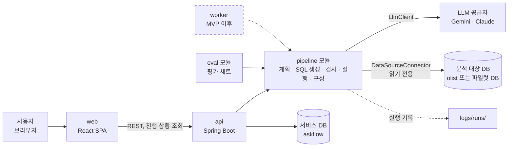
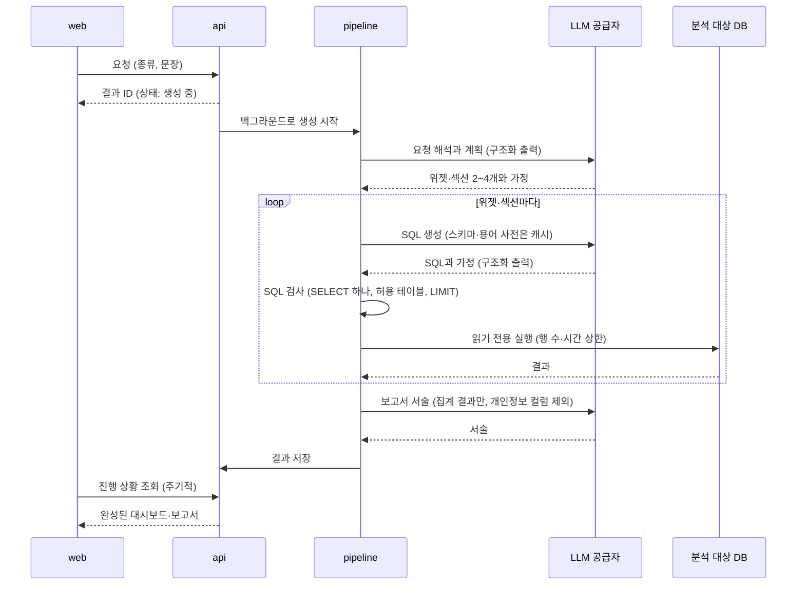
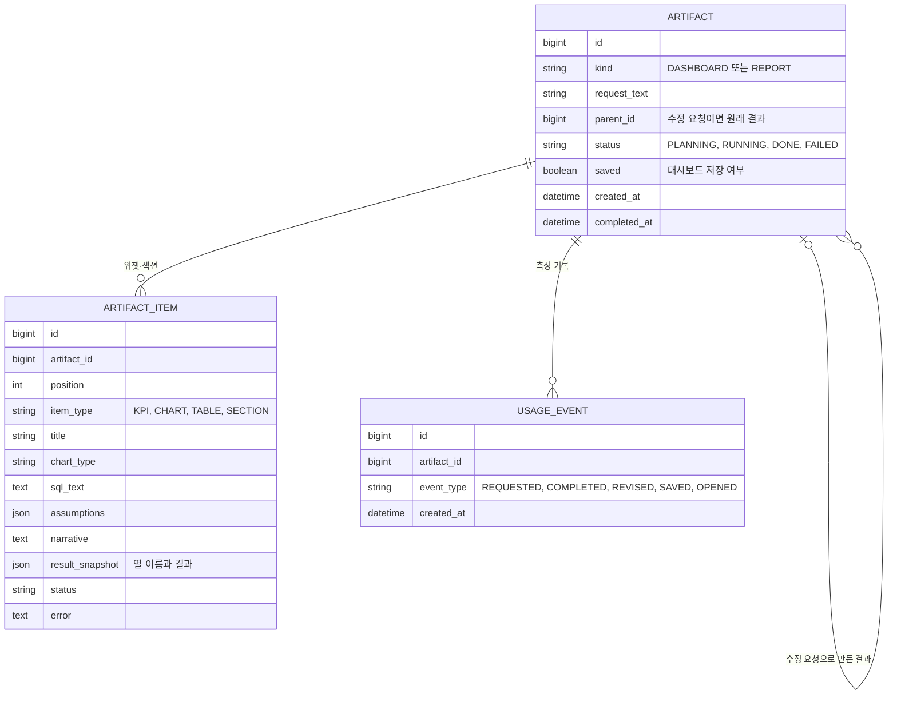
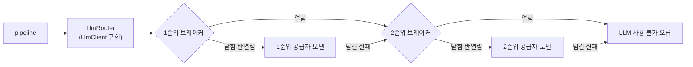

# STEP 5. 아키텍처

- 작성일: 2026-10-27
- 상태: 초안. 라이브러리 버전과 명령은 하네스 구성(로드맵 5-1)에서 확정한다.
- 근거: [PRD](04-prd.md), [IA](03-ia.md), [로드맵의 확정한 것](mvp-roadmap.md#확정한-것)

## 1. 결정 요약

| 항목 | 결정 |
|---|---|
| 백엔드 | Spring Boot, Kotlin, Gradle(Kotlin DSL) 멀티 모듈 |
| 프론트엔드 | React + TypeScript + Vite, shadcn/ui, 차트는 Recharts |
| DB | MySQL 서버 하나에 DB 둘. `askflow`(서비스 데이터)와 `olist`(분석 대상, 읽기 전용) |
| LLM | 공급자는 `LlmClient` 뒤에 두고 설정으로 고른다. 개발·평가는 Gemini API 무료 등급(Gemini 3.8 Flash)으로 시작하고, 파일럿 공급자는 평가 세트로 정한다. 공급자가 계속 실패하면 서킷 브레이커가 다음 공급자로 넘기고, 살아나면 되돌린다(7장) |
| 생성 방식 | API 프로세스 안의 백그라운드 작업. 화면은 진행 상황을 주기적으로 조회한다 |
| Olist 날짜 | 시드할 때 7일 단위로 최근으로 옮긴다 |
| 로컬 환경 | Docker Compose (MySQL) |

## 2. 시스템 구성



- **pipeline 모듈이 핵심이다.** 요청 해석부터 대시보드·보고서 구성까지 여기서 한다. api, eval, 나중의 worker가 같은 모듈을 쓴다. 그래서 워커를 분리할 때 pipeline을 옮기지 않고 호출하는 쪽만 바꾸면 된다.
- **바깥 세계와는 인터페이스로만 닿는다.** LLM은 `LlmClient`, 분석 대상 DB는 `DataSourceConnector`, 실행 기록은 `RunLogger` 뒤에 둔다. MVP 구현체는 Gemini·Anthropic SDK, MySQL, 파일이다. 엑셀·시트 커넥터나 다른 LLM은 구현체를 추가해 붙인다.
- **pipeline은 Spring에 기대지 않는 순수 Kotlin으로 둔다.** 그래서 단위 테스트가 빠르고, 하네스의 Stop 훅에서 매번 돌릴 수 있다.

## 3. 레포 구조

```
askflow/
├── api/            # Spring Boot 앱: REST, 서비스 DB, 구현체 연결
├── pipeline/       # 순수 Kotlin 라이브러리: 생성 파이프라인과 인터페이스
├── eval/           # 평가 세트 실행, 실패 리포트, 요청 재현
├── web/            # React 앱
├── docker/         # 로컬 MySQL 초기화 스크립트
├── scripts/
│   ├── harness/    # Claude Code 훅
│   ├── git-hooks/  # 커밋 메시지·브랜치 검사
│   ├── ralph/      # Ralph 루프
│   └── seed/       # Olist 적재와 날짜 옮기기
├── data/raw/       # Olist 원본 (커밋하지 않음)
├── logs/           # 실행 기록 (커밋하지 않음)
├── docs/, openspec/, conventions/
├── CLAUDE.md
└── docker-compose.yml
```

하네스 구성(5-1)에서 `api/`, `pipeline/`, `web/`, `docker/`, `scripts/harness/`, `scripts/git-hooks/`를 만들었다. `eval/`과 `scripts/seed/`는 F-002 change와 평가 세트를 만들 때, `worker/`는 MVP 이후 워커를 분리할 때 만든다.

## 4. 생성 흐름

### 4-1. 대시보드·보고서 만들기 (F-001 ~ F-005)



- **진행 상황:** 화면은 결과 ID로 1~2초마다 상태를 조회한다. IA의 "생성 중" 상태에서 계획한 위젯·섹션 목록을 보여 주는 데 쓴다. 서버 푸시(SSE)는 MVP 이후다.
- **수정 요청:** 원래 결과와 수정 문장을 함께 넣어 새 결과를 만든다. 원래 결과는 그대로 둔다(IA 4장).
- **부분 실패:** 위젯·섹션 하나가 실패해도 나머지는 계속 만든다. 실패한 것은 오류와 원인을 저장한다.

### 4-2. 저장한 대시보드 다시 열기 (F-005)

저장할 때 위젯마다 SQL과 차트 설정을 저장한다. 다시 열면 LLM을 부르지 않고 저장한 SQL만 다시 실행해, 구성은 그대로 두고 숫자만 최신으로 바꾼다.

## 5. 서비스 DB (askflow)



- 대시보드와 보고서는 같은 테이블(`artifact`)에 두고 `kind`로 나눈다. 위젯과 섹션도 `artifact_item` 하나로 둔다.
- `usage_event`는 PRD 2장의 측정 기록이다(요청·완성 시각, 수정 요청, 저장·열람). 개인정보는 넣지 않는다.
- 스키마 변경은 마이그레이션 도구(Flyway)로 관리한다.

## 6. 분석 대상 DB와 SQL 안전

F-003의 안전은 세 겹으로 지킨다. 바깥 겹부터 막는다.

| 겹 | 방법 |
|---|---|
| 1. DB 계정 | 분석 대상 DB에는 SELECT 권한만 있는 계정으로 접속한다. 연결할 때 권한을 확인해 쓰기 권한이 있으면 홈에 경고한다 |
| 2. DB 세션 | 연결마다 읽기 전용 트랜잭션으로 열고, MySQL의 실행 시간 상한(`max_execution_time`)과 가져오는 행 수 상한을 건다 |
| 3. SQL 검사 | JSqlParser로 SQL을 해석해, SELECT 문 하나인지, 허용한 테이블만 쓰는지 확인하고 LIMIT이 없으면 붙인다 |

LLM에는 스키마, 컬럼 설명, 용어 사전, 집계된 결과만 보낸다. 설정 파일에 지정한 개인정보 컬럼은 결과에서 빼고 보낸다.

## 7. LLM 연동

LLM 공급자는 쉽게 바꿀 수 있어야 한다. 개발과 평가는 비용 없이 Gemini API 무료 등급으로 하고, 파일럿은 데이터 정책 때문에 유료 등급을 써야 하며, 어느 공급자가 나은지는 평가 세트로 재야 하기 때문이다. 공급자 하나가 한도 초과나 장애로 멈춰도 생성이 멈추지 않게 자동으로 다른 공급자로 넘긴다.

### 7-1. 공급자 교체

- **`LlmClient`는 공급자와 무관한 인터페이스다.** pipeline은 무엇을 묻고 어떤 형식으로 받을지만 정하고, 공급자별 요청 형식은 구현체가 맡는다.
  - 받는 것: 단계(계획, SQL 생성, 서술), 고정 앞부분(지시문, 스키마, 컬럼 설명, 용어 사전), 바뀌는 뒷부분(요청 문장, 섹션별 질문), 출력 JSON 스키마.
  - 돌려주는 것: 스키마를 지킨 출력, 실제로 답한 공급자와 모델, 토큰 사용량(캐시 읽기 포함), 종료 사유.
  - 결과 데이터는 F-003의 `LlmSafeResult`, 실행 오류는 `LlmSafeError`로만 넘긴다. 어느 공급자로 가든 개인정보 값은 빠진다.
- **구현체:** `GeminiLlmClient`(공식 Java SDK `com.google.genai:google-genai`)와 `AnthropicLlmClient`(공식 Java SDK `com.anthropic:anthropic-java`). 구조화 출력 지정, 캐싱, thinking 설정, 거절 사유처럼 공급자마다 다른 것은 구현체 안에서 처리한다.
- **고르기는 설정으로 한다.** 단계마다 공급자·모델 목록을 순서대로 적는다(`askflow.llm`). 코드를 고치지 않고 설정만 바꿔 공급자를 바꾼다. API 키는 환경 변수(`GEMINI_API_KEY`, `ANTHROPIC_API_KEY`)로 받는다.
- **프롬프트는 공급자마다 따로 쓰지 않는다.** 같은 프롬프트로 평가 세트를 돌려 공급자·모델을 비교한다. 한 공급자에서만 정답률이 떨어지면 그 구현체 안에서 고친다.

### 7-2. 서킷 브레이커와 자동 전환



- **`LlmRouter`도 `LlmClient`다.** 설정한 순서대로 공급자·모델 목록을 들고, 공급자·모델마다 서킷 브레이커를 하나씩 둔다. pipeline은 라우터를 `LlmClient` 하나로만 본다.
- **브레이커 상태:**
  - 닫힘: 정상으로 부른다. 최근 호출 중 실패 비율이 문턱을 넘으면 열림이 된다.
  - 열림: 그 공급자를 부르지 않고 곧바로 다음 순위로 넘긴다. 정한 시간이 지나면 반열림이 된다. 429 응답이 기다릴 시간을 알려 주면 적어도 그만큼은 열어 둔다.
  - 반열림: 몇 번만 시험 삼아 보낸다. 성공하면 닫힘으로 돌아가 1순위가 다시 일을 맡고(자동 복구), 실패하면 다시 열림이 된다.
- **다음 순위로 넘기는 실패:** 요청 한도 초과(429), 서버 오류(5xx), 연결 실패, 시간 초과, 안전 분류기의 거절.
- **넘기지 않는 실패:** 요청 형식 오류(400)와 인증 오류(401, 403). 설정이나 코드 문제라 다른 공급자로 넘기면 문제가 가려진다. 그대로 오류로 남긴다.
- **스키마를 어긴 출력:** 같은 공급자에 한 번 다시 묻고, 그래도 어기면 다음 순위로 넘긴다.
- **모두 실패하면:** 그 위젯·섹션은 "LLM 사용 불가" 오류로 남기고 나머지는 계속 만든다(4-1의 부분 실패).
- **기록:** 실행 기록(`RunLogger`)과 결과에 실제로 답한 공급자·모델과 전환 여부를 남긴다. 공급자가 바뀌면 같은 요청에도 SQL이 달라질 수 있어 재현과 근거 패널에 필요하다.
- **구현:** Resilience4j의 `resilience4j-circuitbreaker`를 쓴다. Spring 없이 쓰는 Java 라이브러리라 pipeline 규칙(순수 Kotlin)에 맞는다. 문턱과 시간 값은 설정으로 두고 초기값은 F-002 설계에서 정한다.

### 7-3. 데이터 정책에 따른 전환 제한

자동 전환은 데이터를 보내도 되는 공급자 사이에서만 한다. Gemini API 무료 등급은 Google이 입력과 출력을 제품 개선에 쓰고 사람이 읽을 수 있으며, 약관이 기밀·개인 정보를 넣지 말라고 한다. 유료 등급과 Claude API는 기본으로 학습에 쓰지 않는다.

| 환경 | 분석 대상 | 허용 등급 | 예 |
|---|---|---|---|
| 로컬 개발·평가 | Olist(공개 데이터) | 무료, 유료 | Gemini 3.8 Flash → Gemini 3.5 Flash-Lite |
| 파일럿 | 회사 DB | 유료만 | 평가 세트로 고른 유료 공급자 둘 |

- 설정에서 공급자·모델마다 등급을 적고, 환경마다 허용 등급을 정한다. 파일럿 설정에 무료 등급이 들어 있으면 앱이 시작하지 않는다(fail-closed). 장애가 났다고 무료 등급으로 넘어가 회사의 질문, 스키마, 집계 결과가 나가는 일을 막는다.
- 공급자·모델을 전환 목록에 넣기 전에 평가 세트를 그 모델로 돌려 정답률을 확인한다. 전환됐을 때 품질이 크게 떨어지는 모델은 목록에 넣지 않는다.

### 7-4. 공급자별 메모

- **구조화 출력:** 계획(위젯·섹션 목록과 가정)과 SQL 생성 결과를 JSON 스키마로 받는다. Claude Opus 5.5는 특정 도구 호출을 강제할 수 없어 구조화 출력으로 받는다. Gemini도 응답 JSON 스키마를 지정해 받는다.
- **프롬프트 캐싱:** 공급자와 상관없이 같은 내용(지시문, 스키마, 컬럼 설명, 용어 사전)을 앞에, 바뀌는 부분을 뒤에 둔다. 캐시를 켜는 방법과 캐시 적중 확인 방법은 구현체마다 다르니 F-002에서 확인한다.
- **thinking과 effort:** Claude Opus 5.5는 thinking을 끌 수 없고 effort(기본 `medium`)로 깊이를 정한다. Gemini의 thinking 설정과 단계별 값은 F-002에서 평가 세트로 정한다.
- **거절:** 응답의 종료 사유를 항상 확인한다. 거절은 7-2에서 넘길 실패로 센다. Claude의 서버 쪽 대체 모델 설정(fallback)은 같은 공급자 안의 1차 대비로 켜 둔다.
- **쓰지 않는 것:** temperature 같은 무작위성 설정은 어느 공급자에서도 쓰지 않는다(Claude API는 거부한다). 결과를 고정하는 대신 6장의 검사로 안전을 지킨다.

`LlmClient`, 구현체, `LlmRouter`, `askflow.llm` 설정, `.env.example`의 키 설명은 F-002 change(`add-sql-generation`)에서 만든다. 자세한 요청 형식도 F-001, F-002 change의 설계에서 정한다.

## 8. Olist 데이터와 날짜

`scripts/seed/`가 Olist를 개발용 MySQL의 `olist` DB에 넣는다.

1. **원본 받기:** Olist CSV를 `data/raw/olist/`에 둔다. Kaggle 로그인이 필요해 처음 한 번은 사람이 받는다. 비상업 라이선스라 커밋하지 않는다.
2. **적재:** 테이블을 만들고 CSV를 넣는다.
3. **날짜 옮기기:** 마지막 주문일이 어제가 되도록 간격을 계산하되, 7의 배수로 내림한다. 이 간격을 모든 날짜 컬럼에 더한다. 7일 단위라 요일이 원본과 같다.
4. **다시 시드:** 시간이 지나 데이터가 과거가 되면 다시 시드한다. 간격은 매번 그날 기준으로 다시 계산한다.

그래서 생성되는 SQL은 파일럿과 같이 DB의 오늘(`CURDATE()`) 기준으로 기간을 계산한다.

## 9. 평가 세트

- `eval/` 모듈에 질문 30개와 대시보드·보고서 요청 10개를 둔다.
- **정답은 값이 아니라 SQL로 둔다.** 시드할 때마다 날짜가 옮겨져 정답 값이 바뀌기 때문이다. 평가할 때 생성 SQL과 정답 SQL을 같은 DB에서 실행해 결과를 비교한다. 정렬이 없는 질문은 순서를 무시하고 비교한다.
- 용어 사전을 켠 상태와 끈 상태로 각각 돌릴 수 있다(H5).
- 결과는 정답률과 실패 리포트(기대 SQL·결과와 실제 SQL·결과)로 남긴다(하네스 2-6).

## 10. 프론트엔드

- React + TypeScript + Vite로 만든 SPA다. 화면은 IA의 홈, 보고서, 대시보드, 근거 패널이다.
- UI는 shadcn/ui, 차트는 shadcn 차트(Recharts 기반)를 쓴다. 디자인 토큰은 STEP 6에서 정한다.
- API 타입은 백엔드의 OpenAPI 문서(springdoc)에서 TypeScript 타입을 생성해 쓴다. 백엔드와 화면의 데이터 형식이 어긋나지 않게 하기 위해서다.

## 11. 환경과 배포

| 환경 | 구성 |
|---|---|
| 로컬 개발 | Docker Compose로 MySQL(`askflow`, `olist`)을 띄우고, api와 web은 로컬에서 실행 |
| 개발 서버 | `develop` 브랜치를 배포. Olist 데이터 |
| 파일럿 | `main` 브랜치의 태그를 회사마다 따로 배포. 분석 대상은 그 회사의 DB(읽기 전용 계정) |

비밀 값(LLM API 키, DB 계정)은 환경 변수로 넣고 `.env.example`에 이름과 설명만 적는다. 배포할 클라우드는 STEP 7 전에 정한다.

## 12. 하네스 명령

하네스 구성(5-1)에서 확정한 명령은 [하네스 규칙](../../conventions/harness.md) 5장에 있다. web 패키지 매니저는 npm을 쓴다.
평가 세트 실행과 요청 재현은 F-002 change에서 `eval/` 모듈과 함께 만든다(9장).

## 13. OpenSpec change로 넘길 것

PRD 7장의 change마다 설계에서 정한다.

| change | 이 문서에서 가져갈 것 |
|---|---|
| `add-safe-sql-execution` (F-003) | 6장의 세 겹 안전, `DataSourceConnector`, 연결 상태 |
| `add-sql-generation` (F-002) | 7장의 LLM 연동, 용어 사전 설정 파일, 9장의 평가 세트 |
| `add-request-planning` (F-001) | 4-1의 계획 단계, 백그라운드 생성과 진행 상황 조회 |
| `add-unstructured-report` (F-004) | 4-1의 서술 단계, 근거 패널, 공유 링크, 부분 실패 |
| `add-structured-dashboard` (F-005) | 4-2의 다시 열기, 저장 |
